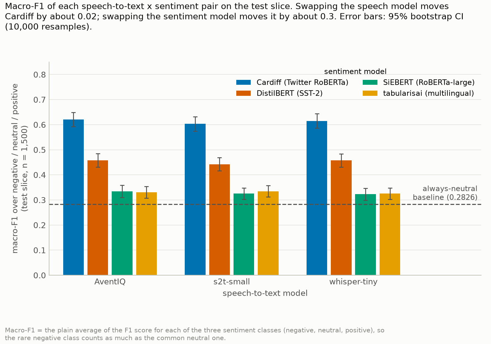
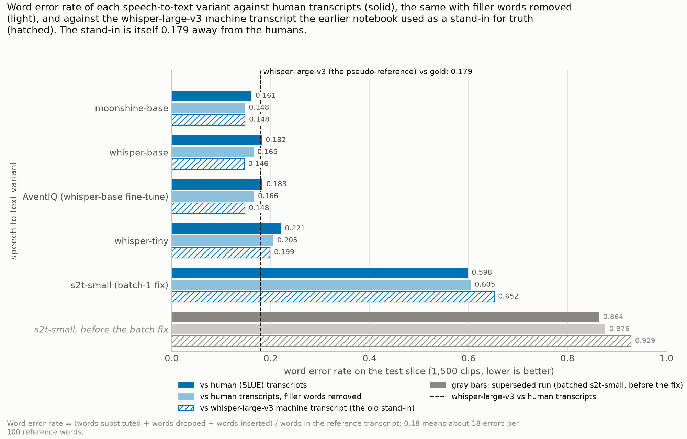
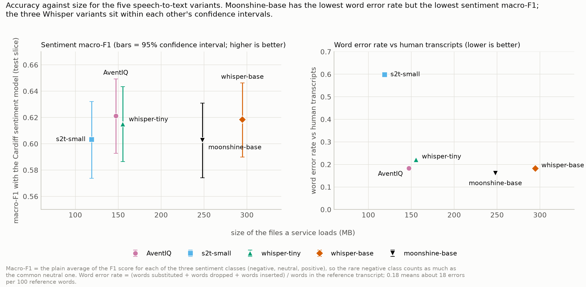
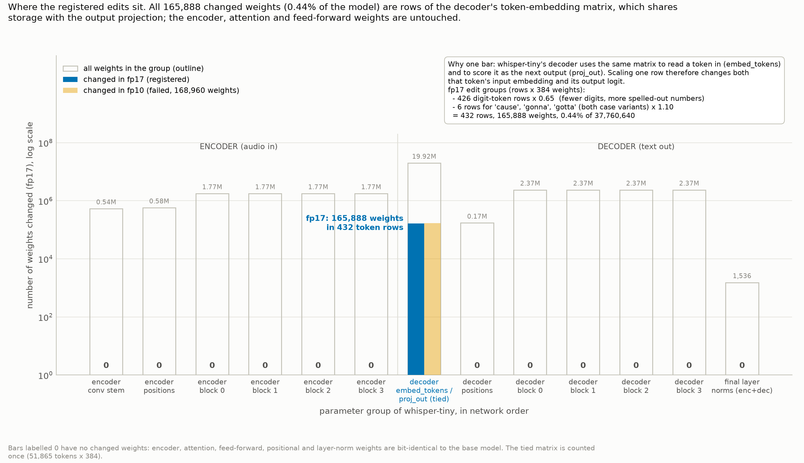
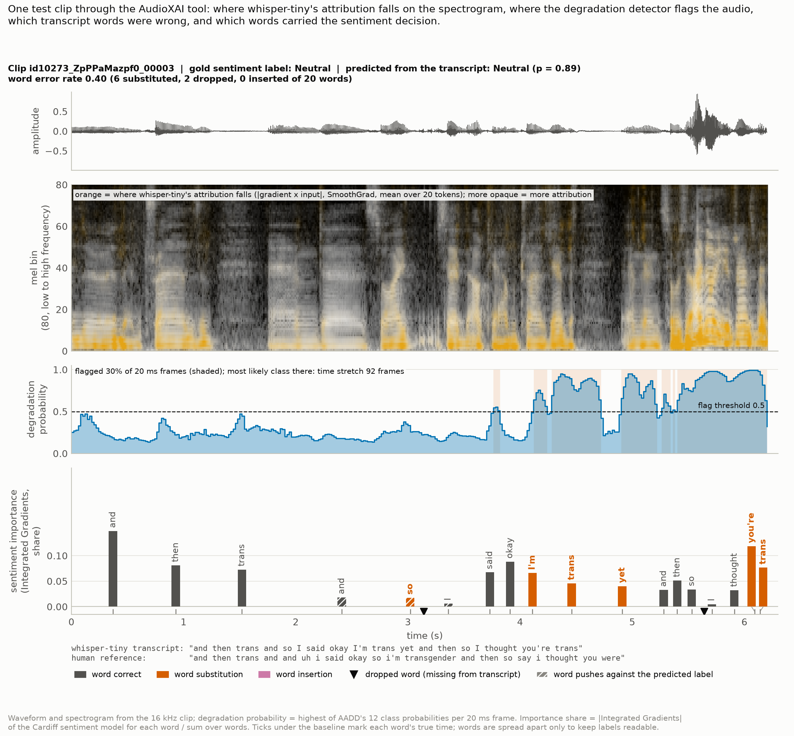
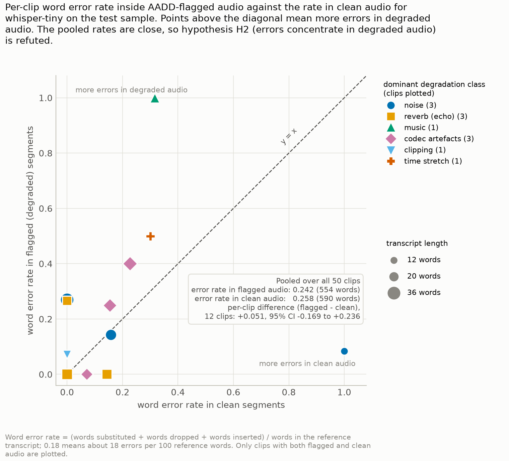

# Milestone 2 on branch `m2-overnight`

This folder holds the overnight run of 2026-11-18 (04:27 to 08:20 CST, one local RTX 4000 Ada). It finishes T1, registers the T2 variants, runs a reduced WSP-Whisper study and a reduced AudioXAI study, and leaves T3 to T7 for the course VM. This page is the short way through it: the theory behind each measurement, then every figure with its reading. If you want one file only, read this one.

Where the rest lives:

- `OVERNIGHT_REPORT.md`: one section per phase, result first, then evidence and limits.
- `../OVERNIGHT_STATUS.md`: the verdict line, the commit hashes, what was not done.
- `../logs/ledger.md`: every decision with its clock time. `../logs/audit_*.md`: what the fresh-context auditors checked.
- `T1_final/`, `T2_variants/`, `WSP_Whisper/`, `AudioXAI/`: code, caches and results per phase. `AudioXAI/README.md` has the tool's usage and its full result list.
- `../figures/`: the 11 figures below, each with a JSON spec naming its data file and that file's SHA-256.

## Theory

### The pipeline and the question

Each clip goes through two models. A speech-to-text model (ASR) turns the audio into a transcript, and a text classifier turns the transcript into negative, neutral or positive. The project question is why swapping the ASR model barely changes the sentiment result. Three answers were possible: the ASR models make the same errors, the classifier ignores the words the ASR gets wrong, or the classifier is the weak link and better text would not help it. The gold-input ablation in Phase 1 and the AudioXAI study in Phase 4 are built to tell these apart.

### Splits and leakage

The 3,426 clips were split once by Chen's notebook and never again: 500 development clips, 1,500 test clips, and a 1,426-clip load pool. Every threshold, label mapping and model choice was tuned on the 500 development clips. Every number reported here comes from the 1,500 test clips. The load pool was never read, because T5's load generator on the course VM needs it untouched.

### Word error rate

WER counts substitutions, deletions and insertions between a hypothesis and a reference, divided by the number of reference words:

$$
\mathrm{WER} = \frac{S + D + I}{N}
$$

It is computed over the whole corpus, so long clips weigh more than short ones. Both texts go through the notebook's `normalize_text` first (lowercase, punctuation removed). Two references are used. The gold reference is the human transcript from the SLUE benchmark, joined to all 3,426 clips with no label disagreement. Against that stands the pseudo reference, the whisper-large-v3 machine transcript the earlier notebook used in place of truth. Being itself 0.179 WER away from the humans, it measures agreement with another model, not accuracy. A filler-free WER (um, uh and friends removed from both sides) is reported as a secondary number.

### Macro-F1 and the baseline

Accuracy rewards a model that always says "neutral", because 73.6% of the test clips are neutral. Macro-F1 averages the F1 score of the three classes with equal weight, so the 2 rarer classes count as much as the common one. The always-neutral baseline scores 0.7360 accuracy but only 0.2826 macro-F1. Every configuration is judged against that 0.2826.

### Confidence intervals

Every CI is a percentile bootstrap: 10,000 resamples of clip indices drawn with `numpy.random.default_rng(8001)`. When two models are compared, the same resampled indices are used for both and the gap is recomputed on each resample. A paired CI that excludes zero means the two models differ on the same clips, which is a stronger claim than two overlapping single-model CIs.

### Assertions

An assertion is a check that runs on a single request without a label, so a service can run it in production. A1 asks for at least 2 words, and A2 for a speaking rate between 0.5 and 5.0 words per second. A3 wants a classifier score at or above a threshold t, where t is chosen on the development clips by balanced accuracy at predicting whether the label is correct. Two new ones follow: A4a, that a second classifier agree with the first, and A4b, that the acoustic degradation detector (AADD) does not flag the clip. Thresholds are tuned per configuration, which has a consequence shown in the figures: pass rate does not rank configurations.

### Gold-input ablation

For each ASR and sentiment pair, the classifier is run on four texts: the raw ASR transcript (full), the same transcript lowercased without punctuation (norm), the human transcript (gold) and the machine pseudo reference (pseudo). The gold minus full gap, with its paired CI, measures how much a perfect transcript would help. It is the direct test of hypothesis H3.

### Variant registry

Each ASR and sentiment variant is recorded with its Hugging Face revision SHA, the SHA-256 of its weight file, the size of the files a service would load (not the sum of every weight format on the Hub) and its test-slice accuracy. The registry is what T3 and T4 load from.

### Weight-space programming (WSP)

WSP edits a model without training. There is no gradient, no optimizer and no search over values. A person loads the weights, reasons about what a tensor computes, writes a hypothesis, changes specific entries and measures the change with a forward pass on practice clips. Each forward pass is a batch of at most 64 practice clips and the budget is 50. Forward passes use only the practice half of the development clips. The holdout half is touched only by a locked evaluation harness whose SHA-256 is pinned before the first edit. The checkpoint with the lowest holdout WER is registered before any edited model sees the test slice. Edits are stored as sparse patches, so the full model is rebuilt from the base weights plus the patch. Whisper-tiny ties its token embedding to its output projection, so an edited embedding row changes both how a token is read and how likely it is to be emitted.

### AudioXAI

The tool asks where in the audio the ASR model looks, and whether that is where the audio is degraded.

- Input: the exact 80-bin log-mel spectrogram the Whisper feature extractor produces (10 ms hop).
- Degradation timeline: AADD 3.1.0 gives 12 class probabilities every 20 ms. A frame is flagged when any class probability reaches 0.5. AADD was trained on synthetic degradations of read speech, so its flags on real interview audio are estimates.
- M1, the primary map: gradient × input on the log-mel for each generated token's teacher-forced log-probability, smoothed with SmoothGrad (16 noisy copies, σ = 0.1 × feature std). It gives a time × frequency map per token.
- M2, model-agnostic: occlude 100 ms × 1/8-mel patches and measure the drop in each token's log-probability, in the spirit of SPES.
- M3, Grad-CAM on the last encoder layer. Time-only, because Whisper's Conv1d front end leaves no frequency axis.
- M4, decoder cross-attention averaged over the alignment heads. Also time-only.
- Word errors against gold from jiwer's alignment, placed on the timeline through token timestamps.
- Sentiment importance: Integrated Gradients on the classifier's embeddings, projected back onto audio time through the word timestamps.

The focus ratio is the attribution mass inside flagged frames divided by the fraction of frames that are flagged. A ratio of 1 means the model attends to degraded audio exactly in proportion to how much of the clip is degraded. Above 1 means it concentrates there.

Two faithfulness checks guard the maps. Deletion curves remove the top k% of patches by attribution and compare the drop in log-probability with removing random patches of the same size. The model-randomization check (Adebayo et al., 2018) re-initializes the top decoder layers and re-runs M1. If the maps barely change, the method is reading the input, not the model.

### The three hypotheses

They were written to `AudioXAI/HYPOTHESES.md` and committed at 04:49, before the test slice was unlocked at 05:05.

- H1 (the project's own guess): ASR attribution concentrates in degraded regions more than their share of the clip. Refuted if the mean focus ratio's CI includes 1.
- H2: ASR errors concentrate in degraded segments and land on words that carry little sentiment. Refuted if the error rate in flagged audio is not higher than in clean audio, or if erroneous words carry their share of sentiment importance.
- H3: the bottleneck is the text classifier, so gold text would not raise macro-F1 beyond its CI. Refuted if the gold minus ASR gap's CI lies above zero.

## Results

Headline numbers from the test slice. Every figure below links to its data file through `../figures/specs/`.

| What | Value |
|---|---|
| Best configuration, Cardiff on AventIQ, macro-F1 | 0.6211 [0.5926, 0.6493] |
| Same classifier on human gold text | 0.6371 |
| Always-neutral baseline macro-F1 | 0.2826 |
| WER vs humans: moonshine / whisper-base / AventIQ / whisper-tiny / s2t | 0.1612 / 0.1817 / 0.1831 / 0.2206 / 0.5983 |
| WSP fp17, change in test WER | −0.0054 [−0.0079, −0.0026] |
| WSP fp17, change in Cardiff macro-F1 | −0.0064 [−0.0119, −0.0016] |
| H1 focus ratio, 300 clips, whisper-tiny | 0.994 [0.966, 1.021] |
| H3 gold minus ASR macro-F1, Cardiff on whisper-tiny | +0.022 [0.003, 0.042] |

### Phase 1: the sentiment model decides, the speech model barely matters

Macro-F1 of each ASR × sentiment pair with 95% CIs. Read it by columns: swapping the speech model moves Cardiff by about 0.02, swapping the sentiment model moves it by about 0.3. The worst pair, whisper-tiny with SiEBERT, scores 0.3228, barely above the 0.2826 baseline, because a binary model cannot produce the neutral class that 73.6% of clips carry.

The same classifier on the ASR transcript (full), the normalized transcript (norm) and the human transcript (gold). Normalization changes almost nothing. Human text adds at most 0.034 macro-F1 for Cardiff (s2t: 0.6032 to 0.6371), and the gap for whisper-tiny is +0.022 with a CI above zero. That small gain is the H3 result: the classifier on perfect text tops out at 0.637, so better transcripts cannot move the pipeline much.

Assertion pass rate against macro-F1 over 12 configurations. Left uses A1 to A3 (Pearson −0.24), right adds classifier agreement A4a (Pearson −0.08). Each configuration's threshold is tuned on its own development scores, so a high pass rate says the thresholds are lenient, not that the configuration is good. Pass rate is a per-request guard, not a model selector. A3 is useless for the two binary classifiers, whose scores sit at 0.99 on almost every clip.

Not in a figure: the s2t model's reported 0.93 WER was partly a measurement artefact. Transcribing one clip at a time instead of eight cut looping outputs from 244 to 134 of 1,500 and WER against humans from 0.864 to 0.598. The cause is batch padding.

### Phase 2: six speech models, four classifiers, one registry

WER against human transcripts (solid), without fillers (light), and against the whisper-large-v3 pseudo reference (hatched). Moonshine-base is the most accurate against humans at 0.1612. The three Whisper variants sit between 0.1817 and 0.2206, and the edited whisper-tiny-wsp row is at 0.2152. Note the dashed line at 0.179: that is how far the pseudo reference itself is from the humans, which is why the earlier WER numbers against it ranked models differently.

Cardiff macro-F1 against model size for the five ASR variants. Moonshine-base has the lowest WER and the lowest macro-F1 (0.6027). AventIQ at 147 MB is a fine-tune of whisper-base at 295 MB: their weights differ by at most 0.0023 and their macro-F1 by 0.003. Size buys nothing here because the classifier, not the transcript, sets the ceiling.

### Phase 3: a real but useless WER gain from 432 embedding rows

Base whisper-tiny, the failed fp10 checkpoint and the registered fp17, all on the 1,500 test clips through the locked harness. fp17 rescales 426 digit-containing token rows by 0.65 and the `cause`, `gonna`, `gotta` rows by 1.10, so numbers get spelled out the way the human transcripts write them. WER falls by 0.0054 with a paired CI that excludes zero. Cardiff macro-F1 falls by 0.0064, also with a CI that excludes zero. WER against the pseudo reference rises from 0.1988 to 0.2100, which shows the gain is a style match to the human transcripts, not better hearing. fp10 is kept in the table as the failure it was: raising the uh/um rows sent 18 clips into repetition loops.

All 165,888 changed weights (0.44% of the model) are rows of the decoder's token-embedding matrix, which shares storage with the output projection. Encoder, attention and feed-forward weights are untouched. Only 17 of the 50 forward passes were used, so fp25 and fp50 do not exist and the study is partial by the brief's own rule (40 passes before any null result).

### Phase 4: the speech model does not stare at the bad audio

One test clip (gold neutral, predicted neutral, WER 0.40, degradation class time-stretch, 29.6% of frames flagged). Top to bottom: waveform, log-mel with the M1 attribution overlay, the AADD timeline, the transcript colored by error type, and which words carried the sentiment decision. The attribution follows the speech, flagged or not.

Focus ratio per clip, by AADD class, on the 50-clip headline sample. The mean is 0.991 [0.911, 1.061] on the 34 clips that have at least one flagged frame, and the CI includes 1. On the 300-clip extension it is 0.994 [0.966, 1.021] on 214 clips. M2, M3 and M4 agree, and whisper-base and AventIQ give 0.991 on the same 50 clips. H1 is refuted everywhere it was tested. The only classes whose CIs exclude 1 at n = 300 are music (1.060, n = 21) and hum (0.837, n = 12), and those are exploratory.

Per-clip error rate inside flagged audio against the rate in clean audio. On the 50-clip sample the pooled rates are 0.242 flagged against 0.258 clean. At 300 clips the pooled rate is higher in flagged audio (0.343 against 0.223), but within clips that have both kinds of audio the paired difference is negative (−0.126 [−0.275, −0.017], n = 85), and erroneous words carry slightly more than their share of sentiment importance (+0.020 [0.010, 0.032]). Both halves of H2 fail: errors do not hide in degraded audio, and they do not avoid the sentiment-bearing words.

Removing the patches M1 ranks highest lowers whisper-tiny's confidence faster than removing random patches of the same size: area under the curve 1.426 against 1.181, difference 0.245 [0.187, 0.303], top above random on 19 of 20 clips. The maps carry real signal about the input. They fail the other check: after re-initializing the top two decoder layers, the absolute maps correlate at ρ = 0.916 with the originals, far above the 0.5 rule, and |M1| correlates 0.78 with |input|. Gradient × input here is dominated by the spectrogram's own structure, so the focus-ratio result is a statement about where the energy is, confirmed by the model-agnostic M2 (focus ratio 0.989 [0.917, 1.069] on 100 clips).

### The answer in one paragraph

The speech model barely matters because the classifier is the ceiling. Human transcripts raise Cardiff's macro-F1 by only 0.02 to 0.03, while changing the classifier moves it by about 0.3. The predicted label is the same on ASR text and on gold text for about 92% of clips, and the two Whisper sizes agree with each other on 92% as well. The ASR models do not attend to degraded audio more than its share of the clip (H1), their errors do not concentrate there or avoid the sentiment-bearing words (H2), and perfect text helps only a little (H3, refuted by its own criterion but with a small effect). Making the speech model better, including by weight edits that lower WER, does not move sentiment accuracy.

## What is still open

- T3 to T7 on the course VM: services importing `T1_final/pipeline/assertions.py`, deployment from the registry, the load generator on the untouched load pool, CPU-side latency for the SLA, and the analysis task, whose gold-input ablation is already in `T2_variants/results/gap_ci.csv`.
- WSP: passes 18 to 50, the fp25 and fp50 checkpoints, and the 40-pass floor before a null result can be declared.
- AudioXAI: 300 clips for whisper-base and AventIQ (50 done), M2 and segment replacement on 100 (M2 done on 100, segment replacement on 10).
- MinIO upload of the registry: the server was unreachable.
- The per-clip `.npz` attribution arrays (about 1.9 GB) and the AADD scans are gitignored and exist only on the machine that ran this.
